<div align="center">

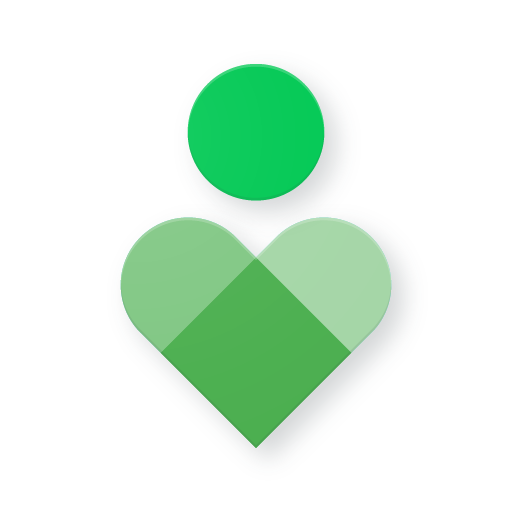

# Digital Wellbeing for Windows

### A calmer relationship with your PC.

Digital Wellbeing tracks your screen time, protects your attention, and filters the web — all locally, with an Apple-grade interface inspired by macOS Sequoia.

[](https://github.com/princechouhan19/Digital-Wellbeing-PC/releases)
[](https://www.python.org/)
[](https://www.qt.io/)
[](https://www.microsoft.com/windows)
[](PRIVACY.md)
[](LICENSE)

[**Download Installer (v4.4.1)**](https://digitalwellbeing.vercel.app) • [**User Guide**](docs/USER_GUIDE.md) • [**Architecture**](docs/ARCHITECTURE.md) • [**Roadmap**](ROADMAP.md) • [**Contributing**](CONTRIBUTING.md) • [**Website**](https://digitalwellbeing.vercel.app)

</div>

---

## Overview

Digital Wellbeing helps you understand and reclaim your computer time. It monitors active windows, user idle periods, and daily/weekly/monthly application usage — transforming raw data into actionable boundaries: **Focus sessions**, **daily app limits**, **website blocking**, and **system-wide adult content filtering**.

Tracking runs quietly in the background with negligible CPU footprint; the **Aurora interface** is ready whenever you need insight or focus.

> **100% Local-First:** No user account, no cloud telemetry, no analytics tracking. All data is persisted strictly to a local SQLite database on your machine.

---

## Screenshots & Interface Showcase

### Desktop Dynamic Notch & Smart Tasks

| Smart To-Do List & Process Linking | Ambient Dynamic Desktop Notch |
| :---: | :---: |
| 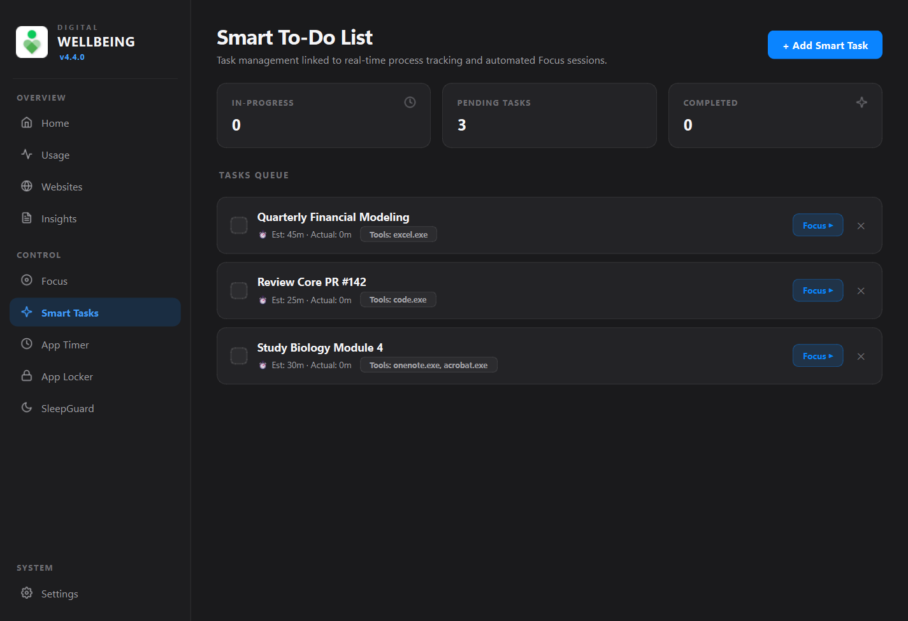 |  |
| *Smart task queue directly linked to target apps, duration budgets, and one-click Focus* | *Nectar-inspired screen-edge dynamic pill with spring expand-on-hover & live focus timing* |

---

### Dashboard & Focus Cockpit

| Real-time Activity Rings | Focus Mode & Attention Blocker |
| :---: | :---: |
| 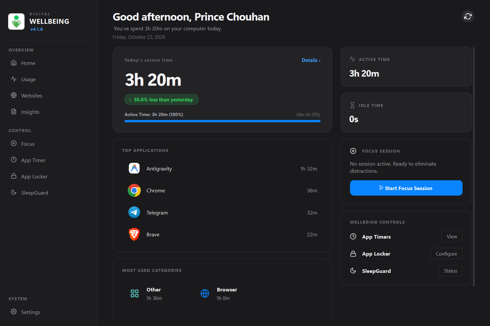 | 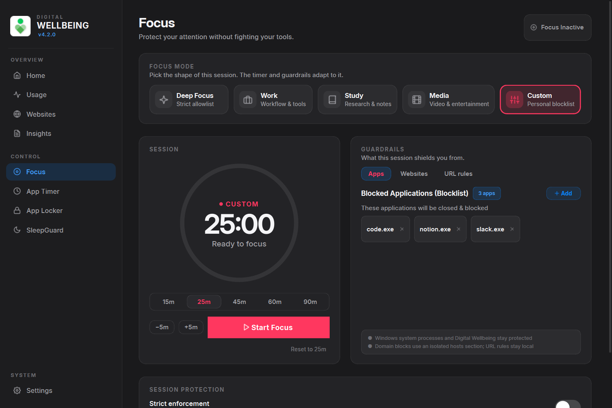 |
| *Real-time category donut ring, top metrics, hourly curve & timeline* | *Pill-rounded cockpit, preset allowlists, tab-level URL closing, and safe lockout* |

---

### Deep Analytics & Historical Navigation

| Interactive Period Insights | Activity Trends with Date Navigation |
| :---: | :---: |
| 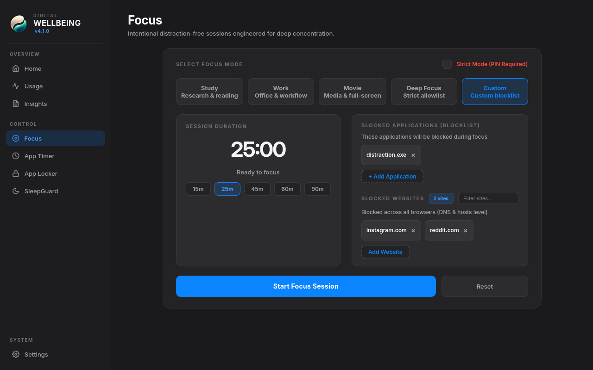 | 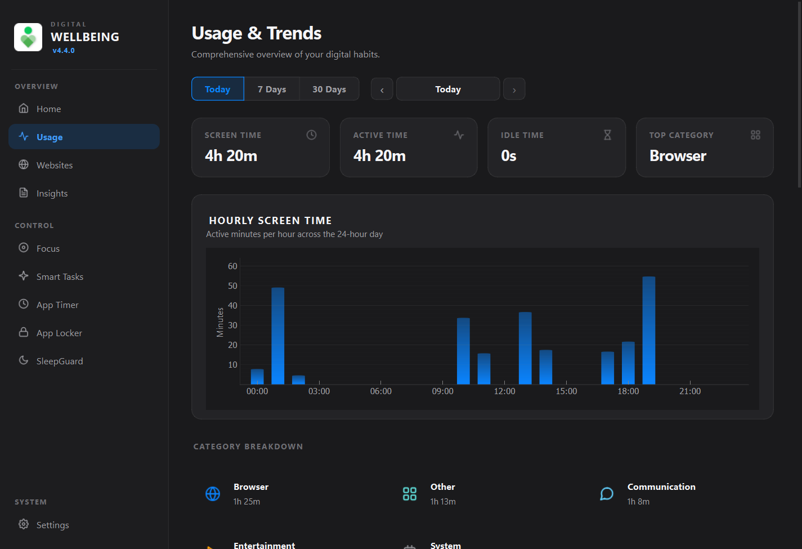 |
| *Weekly, monthly, and yearly switcher with automated period comparisons and trend scoring* | *Hourly application logs with interactive ‹ [Date] › historical day navigation* |

---

### SleepGuard & Website History

| Redesigned SleepGuard Bedtime Hero | Websites Tracker with Date Navigation |
| :---: | :---: |
| 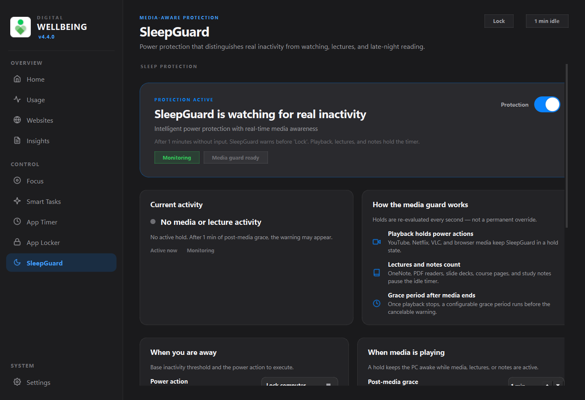 | 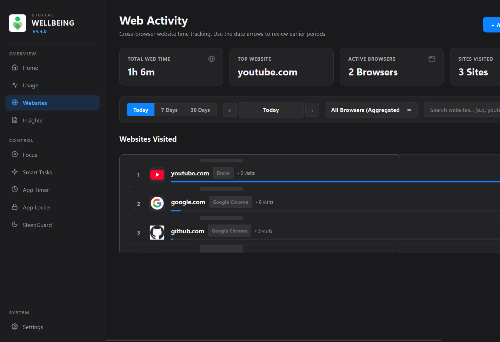 |
| *Modern hero layout with live media/lecture detection preventing unwanted bedtime sleep* | *Domain-level web tracking with interactive ‹ [Date] › historical browsing controls* |

---

### Parental Controls & Diagnostics

| Parental Controls & Productivity Settings | Session Logs & Live System Diagnostics |
| :---: | :---: |
| 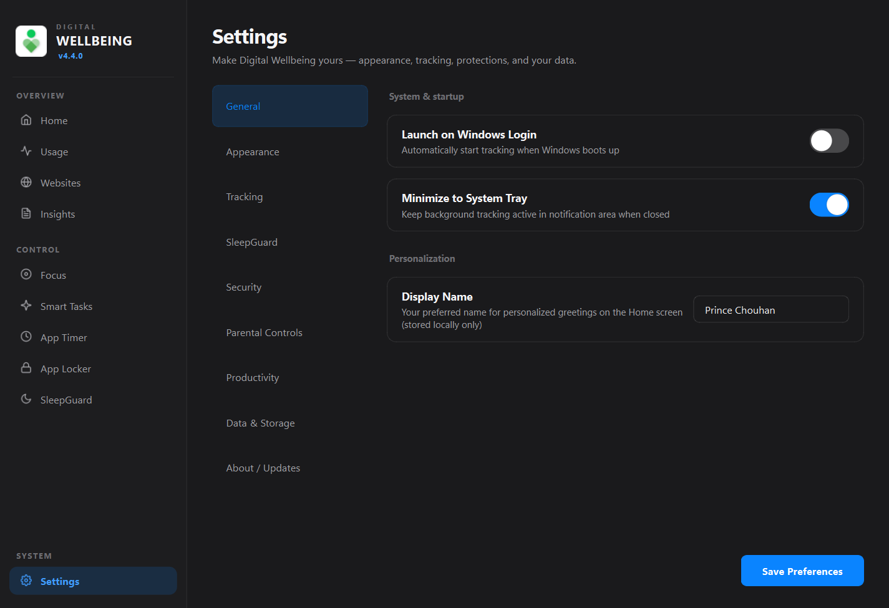 | 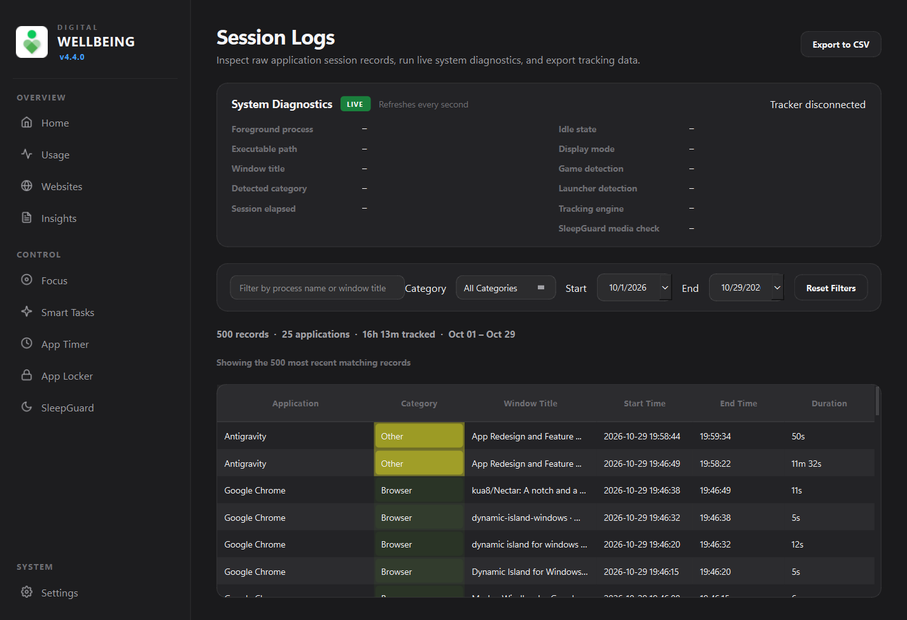 |
| *Block short-form doomscrolling (YT Shorts, Reels, TikTok) and esports/gaming (BGMI, Free Fire)* | *Professional system diagnostics panel monitoring event hooks, ticks, and memory with zero emojis* |

---

### Security & Boundaries

| App Locker & Windows Hello | SafeBrowse Content Shield |
| :---: | :---: |
| 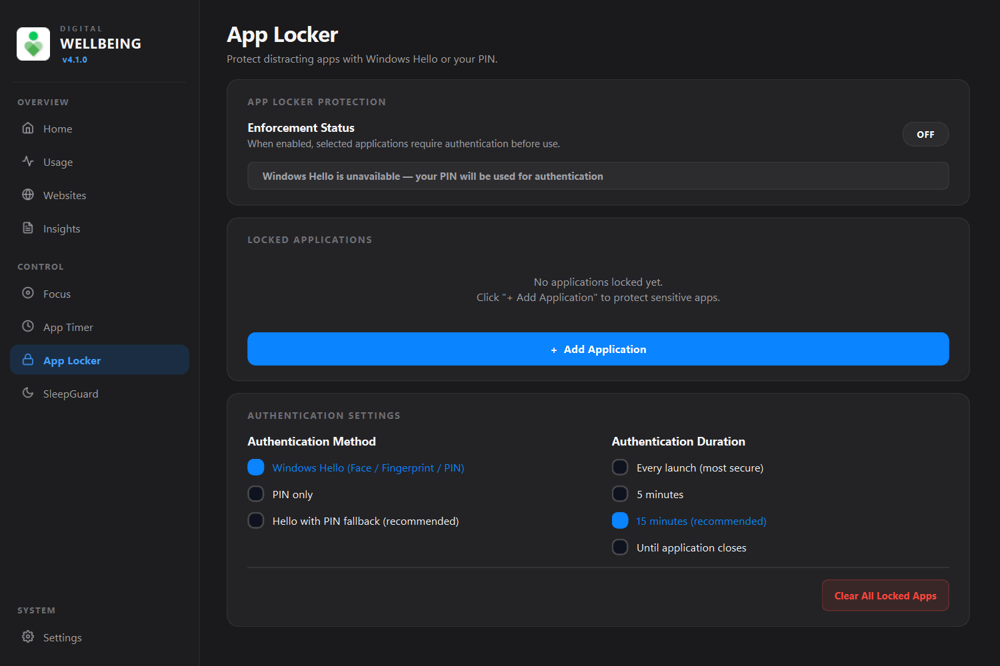 | 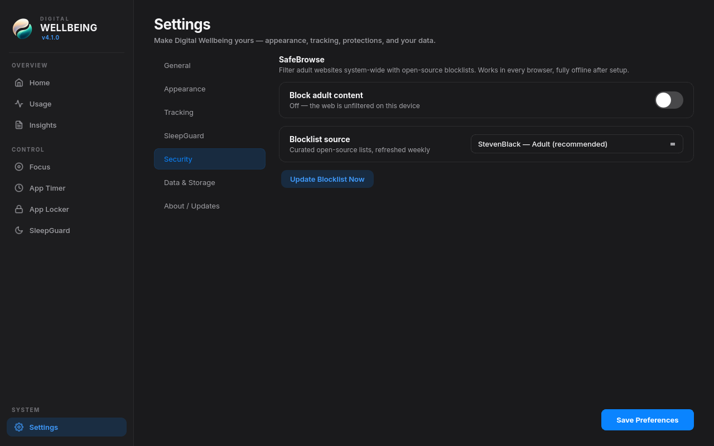 |
| *Biometric face/fingerprint authentication via native Windows Hello* | *DNS-level adult content filter powered by StevenBlack open-source hosts* |

---

## Key Features

### 1. Smart To-Do List Integration
- **Process-Linked Task Management**: Bind tasks directly to desktop applications (`code.exe`, `cursor.exe`, `figma.exe`, `word.exe`).
- **Active Time Calibration**: Digital Wellbeing tracks real active foreground seconds inside linked applications, accurately comparing actual work time against estimated task durations.
- **One-Click Focus**: Hit the focus action on any task to instantly initiate an attention-locked Focus session centered around that task's tools.
- **Priority & Status Tracking**: Categorize tasks by priority (*Low*, *Medium*, *High*, *Urgent*) and progress (*Pending*, *In Progress*, *Completed*).

### 2. Ambient Desktop Dynamic Notch (Nectar-Inspired)
- **Fluid Screen-Edge Pill**: Inspired by [Nectar](https://github.com/kua8/Nectar) / macOS Dynamic Island, a minimalist floating pill (`260x32px`) rests seamlessly at the top edge of your primary screen.
- **Spring Expand-on-Hover**: Hovering smoothly expands the island into an interactive command cockpit (`440x200px`) using Apple-style spring animations.
- **Live Focus & Task Visibility**: Features live session countdowns, active task titles, target tool tags, and a pulsing status dot.
- **Unobtrusive Media Awareness**: Automatically passes mouse events and hides during fullscreen video playback and games.

### 3. Intelligent SleepGuard with Media & Lecture Awareness
- **Hero Card Redesign**: Complete UI visual overhaul with semantic status indicators, circadian warmth controls, and instant safety test modals.
- **Media Player & Video Detection**: Avoids false-positive sleep triggers while enjoying movies or videos in VLC, MPV, MPC, PotPlayer, Plex, or streaming platforms (YouTube, Netflix, Prime Video).
- **Lecture & Study Protection**: Detects online lectures (Coursera, edX, Udemy, Khan Academy), PDF viewers (Acrobat, Sumatra), and note-taking suites (OneNote, Obsidian, Notion) so study sessions are never interrupted.
- **Circadian Display Warm-Up**: Reversible per-monitor gamma ramps shift color temperature toward warm targets before bedtime.

### 4. Parental Controls & Doomscrolling Guard
- **Anti-Doomscrolling Shield**: One-click toggles block addicting short-form feeds including YouTube Shorts (`youtube.com/shorts`), Instagram Reels (`instagram.com/reels`), and TikTok.
- **Battle Royale & Gaming Blocker**: Restrict high-distraction games including Free Fire, PUBG, BGMI, Valorant, CS2, Fortnite, and Roblox.
- **Custom Content Blocker**: Easily blacklist arbitrary distracting domains, games, or keywords.
- **Productivity Defaults**: Enforce daily screen time targets and automatically engage Focus on system startup.

### 5. Interactive Period Insights & Historical Navigation
- **Interactive Period Analytics**: Switch smoothly between Weekly, Monthly, and Yearly aggregates with automatic period-over-period comparisons (`VS PREVIOUS PERIOD`, `PEAK DAY`, and productivity trend scores).
- **Historical Date Browsing**: Intuitive `‹` `[Date]` `›` calendar controls on both the **Activity** and **Websites** pages enable easy retrospective analysis of past days.

### 6. Clean Session Diagnostics & Dev Logs
- **Professional System Diagnostics**: Overhauled Dev Logs page into a clean "Session Logs" surface displaying live WinEvent hook latency, wakeup events, database flush ticks, and memory metrics.
- **Strict Copywriting**: Zero emojis and concise technical diagnostics for clean operational debugging.

### 7. Aurora Design System
- Built to Apple Human Interface Guidelines (HIG) standards: SF-metric typography (bundled Inter & Inter Display), refined materials, fluid spring animations, and Apple system color tokens (`#0A84FF` / `#007AFF`).
- Seamless support for Dark Mode, Light Mode, and automatic Windows System appearance matching.
- Haptics-lite sound feedback utilizing native Windows system audio cues.

### 8. Intelligent Screen Time Tracking
- Real-time foreground application tracking (process binary, path, and window title) driven by `SetWinEventHook` foreground/title notifications instead of a 500 ms polling loop.
- Wraparound-safe idle detection via `GetLastInputInfo`.
- Cached UI Automation fallback for active browser tab domain extraction across **Chrome**, **Edge**, **Brave**, **Firefox**, **Opera**, and **Vivaldi**.
- Crash-safe 30-second heartbeat database synchronization ensuring zero data loss.
- Detection of native Win32 power management events (Lock, Unlock, Sleep, Resume, Shutdown).
- Lazy Qt page construction keeps cold startup around 0.2 s; see [`docs/PERFORMANCE.md`](docs/PERFORMANCE.md) for measured numbers.

### 9. SafeBrowse Content Shield
- System-wide adult content filter blocking over 100,000+ adult and malicious domains at the DNS resolution layer.
- Powered by open-source, community-curated blocklists (**StevenBlack/hosts**, MIT License).
- Ships with an offline seed list enabling immediate filtering from first launch.
- Automatic weekly background synchronization with dedicated, atomic hosts-file management (`# DW-SAFEBROWSE`).
- **Zero packet sniffing or local VPNs:** Functions safely in every browser, normal and private/incognito windows alike.

### 10. Focus Mode & Distraction Blocker
- Curated presets: *Study*, *Work*, *Movie*, *Deep Focus*, and *Custom*, with modernized pill-rounded action buttons (`999px`).
- Strict **Allowlist Mode** (only approved applications run) or **Blocklist Mode** (restricts distracting apps).
- **Granular sub-path rules** — block `youtube.com/shorts` or `reddit.com/r/all` while allowing `reddit.com/r/programming`.
- **Recurring Focus schedules** — weekday/time/mode blocks auto-start, and join the remaining block if you open the app late.
- **Session recap** — after every session see blocked interruptions, fragmentation vs. your baseline, and the best next focus window.
- **Strict Lockout**: optional non-cancelable sessions with a persisted deadline and emergency exit cooldown.

### 11. Attention Quality & Flow Analytics
- **Focus Fragmentation Index** — switches per active hour charted across the day.
- **Flow Continuity Tracker** — highlights sustained 45+ minute productive runs in programming, writing, and study tools.
- **Weekly attention report** — 7×24 heatmap, flow streaks, best/worst hours, CSV/PDF export, and clipboard summary.
- **Real-time nudge** — after 12 switches in 30 minutes, a one-click 10-minute Focus reset appears.
- **Command palette** — `Ctrl+K` for navigation, Focus starts, rules, schedules, and the weekly report.

### 12. App Locker with Windows Hello
- Protect sensitive applications behind biometric authentication.
- Direct integration with native Windows Hello via WinRT (`UserConsentVerifier`) for instant facial or fingerprint unlock.
- Salted PBKDF2 / SHA-256 local PIN fallback when biometric hardware is unavailable.
- Configurable authentication frequencies: *Every Launch*, *5 Minutes*, *15 Minutes*, or *Until Application Closes*.

### 13. Unified App & Website Timers
- Configure daily usage quotas for specific software or web domains.
- Non-intrusive toast notifications when approaching limits (80% warning threshold).
- Graceful countdown dialogs and hard lockouts when daily time expires.

---

## Architecture Overview

Digital Wellbeing follows a clean, decoupled architecture:

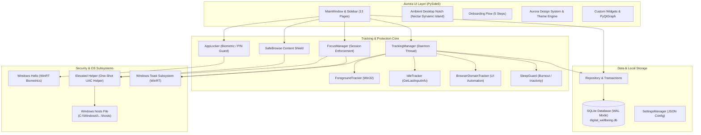

For full architectural details, consult the [Architecture Documentation](docs/ARCHITECTURE.md).

---

## Installation

### Standard Windows Installer (Recommended)
Download and run the installer from the [Releases page](https://digitalwellbeing.vercel.app):
```text
DigitalWellbeingSetup-4.4.1.exe
```

### Running from Source

#### Prerequisites
- Windows 10 (version 1809+) or Windows 11 (64-bit)
- Python 3.11, 3.12, or 3.13 (64-bit)
- Git for Windows

```powershell
# 1. Clone the repository
git clone https://github.com/princechouhan19/Digital-Wellbeing-PC.git
cd digital-wellbeing

# 2. Create and activate a virtual environment
python -m venv venv
.\venv\Scripts\Activate.ps1

# 3. Install dependencies
pip install -r requirements.txt
```

---

## Running the Application

### 1. Interactive GUI
Launch the main desktop application:
```powershell
python main.py
```

### 2. Minimized to System Tray
Launch directly to the system notification area (ideal for startup / Task Scheduler):
```powershell
python main.py --background
```

### 3. Headless Tracking Service
Run tracking in the background with zero GUI memory overhead (~15–25 MB RAM):
```powershell
python main.py --service
```

### 4. Elevated Helper
Perform privileged hosts operations via User Account Control (UAC):
```powershell
python main.py --elevated-helper --action focus-apply --domains "reddit.com,youtube.com"
```

For full details on CLI flags, see the [CLI Reference](docs/CLI_REFERENCE.md).

---

## Building from Source

Digital Wellbeing provides an automated build script (`build.py`):

```powershell
# Compiles PyInstaller binary and generates Inno Setup installer
python build.py
```

To build standalone binaries manually with PyInstaller:
```powershell
pyinstaller digital_wellbeing.spec --clean --noconfirm
```
The output will be generated at `dist/DigitalWellbeing/DigitalWellbeing.exe`.

---

## Project Structure

```
digital-wellbeing/
├── main.py                      # Application entry point (GUI, service, UAC helper)
├── core/                        # Global constants, versioning, logger
│   ├── constants.py             # Enums, Apple system color tokens, timing constants
│   ├── logger.py                # Rotating logger
│   └── version.py               # Version accessor
├── database/                    # SQLite local persistence engine
│   ├── schema.py                # Table schemas and DDL migrations
│   ├── models.py                # Dataclasses and models
│   └── repository.py            # SQLite WAL mode repository, transactions, queries
├── tracker/                     # Screen time, foreground, and session monitoring
│   ├── foreground.py            # Win32 foreground window & process tracker
│   ├── idle.py                  # User idle detection via GetLastInputInfo
│   ├── browser_domain.py        # Active browser tab domain extraction (UI Automation)
│   ├── categorizer.py           # Process-to-category classification engine
│   ├── media_awareness.py       # Active video player, lecture & note application detector
│   ├── sleepguard.py            # Inactivity and late-night rest detector
│   └── manager.py               # Background TrackingManager coordinator thread
├── protection/                  # Focus, limits, SafeBrowse, and access control
│   ├── focus_manager.py         # Focus session management and allowlist/blocklist rules
│   ├── content_guard.py         # Doomscrolling & gaming content blocker
│   ├── app_locker.py            # Biometric & PIN app protection guard
│   ├── content_blocker.py       # SafeBrowse adult content hosts manager
│   ├── windows_hello.py         # WinRT UserConsentVerifier biometric integration
│   ├── pin.py                   # Salted PBKDF2 PIN hashing and verification
│   ├── website_blocker.py       # Focus website hosts file blocker
│   └── elevated_helper.py       # One-shot privileged helper for UAC operations
├── analytics/                   # Aggregation and analytics engine
│   └── engine.py                # Screen time computation, trends, daily stats
├── ui/                          # Aurora Apple-grade PySide6 graphical interface
│   ├── app.py                   # DigitalWellbeingApp lifecycle & QApplication wrapper
│   ├── main_window.py           # Main window chrome, sidebar, and layout
│   ├── design_system.py         # Aurora design system tokens, fonts, and metrics
│   ├── theme.py                 # Dynamic dark/light QSS stylesheets
│   ├── onboarding.py            # 5-step interactive onboarding experience
│   ├── pages/                   # 13 application pages (Dashboard, Tasks, Focus, etc.)
│   └── widgets/                 # Reusable Aurora widgets (Ambient Notch, Rings, Cards)
├── notifications/               # Native Windows toast notifications
│   └── notifier.py              # WinRT / Windows toast notification dispatcher
└── utils/                       # System helpers, autostart, updater, elevation
    ├── elevation.py             # UAC elevation launcher (ShellExecuteEx)
    ├── autostart.py             # Windows Registry Run key manager
    ├── updater.py               # GitHub Releases auto-update checker & SHA-256 verifier
    └── csv_exporter.py          # CSV activity history export
```

---

## Documentation Index

- 📘 [**User Guide**](docs/USER_GUIDE.md): Complete end-user manual for all features and settings.
- 📐 [**Architecture Guide**](docs/ARCHITECTURE.md): Deep dive into subsystems, threading, and data models.
- 🛠️ [**Developer Guide**](docs/DEVELOPER_GUIDE.md): Development setup, coding guidelines, and testing.
- 💻 [**CLI Reference**](docs/CLI_REFERENCE.md): Command line flags and headless service documentation.
- 🔍 [**Troubleshooting**](docs/TROUBLESHOOTING.md): Solutions for permissions, antivirus false positives, and Windows Hello.
- 🔒 [**Security Policy**](SECURITY.md): Vulnerability reporting, threat modeling, and defense-in-depth principles.
- 🛡️ [**Privacy Policy**](PRIVACY.md): Detailed local-first data guarantees and privacy architecture.
- ⚖️ [**Legal Notices**](LEGAL.md): Third-party software licenses, trademarks, and disclaimers.
- 🤝 [**Contributing Guidelines**](CONTRIBUTING.md): How to contribute, report bugs, and propose features.
- 📜 [**Code of Conduct**](CODE_OF_CONDUCT.md): Community standards and enforcement pledge.
- 🗺️ [**Product Roadmap**](ROADMAP.md): Upcoming features, Connect with Phone, and engine optimizations.

---

## Security & Privacy Guarantee

- **Zero Cloud Storage:** Everything is stored locally in `%LOCALAPPDATA%\DigitalWellbeing\digital_wellbeing.db`.
- **Zero Telemetry by Default:** Telemetry is strictly opt-in and disabled by default.
- **Biometric Security:** Biometric credentials are authenticated entirely by the Windows OS; no biometric data ever touches application memory.
- **Atomic Hosts Updates:** All hosts updates create an atomic backup (`hosts.dw.bak`) before modification and are restored cleanly upon exit or uninstallation.

---

## License

Digital Wellbeing for Windows is open-source software licensed under the **[MIT License](LICENSE)**.

```
Copyright (c) 2026 Prince Chouhan and Digital Wellbeing Contributors
```
