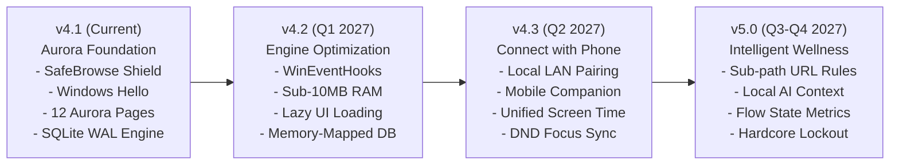

# Digital Wellbeing — Product Roadmap

This document outlines the strategic vision, upcoming capabilities, architectural optimizations, and feature roadmap for **Digital Wellbeing for Windows**.

---

## Strategic Vision

Digital Wellbeing is built on three core pillars:
1. **Apple-Grade Aesthetic:** Fluid, elegant, calm user interfaces that respect your attention rather than demanding it.
2. **100% Local-First Privacy:** Zero cloud accounts, zero telemetry by default, and cryptographic security for all local data.
3. **Actionable Attention Control:** Going beyond passive statistics to provide real-time boundaries, focus enforcement, and cross-device wellness.

---

## Roadmap Milestones Overview

---

## 1. Connect with Phone (Cross-Device Companion & Sync)

A major milestone in Digital Wellbeing's evolution is seamless, private interoperability between your Windows PC and your mobile devices (Android and iOS).

### A. Local Peer-to-Peer Wi-Fi Pairing (Zero Cloud Relay)
- **Zero-Cloud Discovery:** Pairing occurs over your local Wi-Fi network using standard **mDNS / Bonjour (Zeroconf)**. No central servers, account logins, or cloud databases are used.
- **QR Code Handshake:** Scan an on-screen QR code from the desktop app to establish an end-to-end encrypted connection via **Curve25519 key exchange** and **ChaCha20-Poly1305 / AES-256-GCM** encryption.
- **Encrypted Local WebSocket / LAN Sync:** Metrics and commands are synchronized locally between devices within milliseconds whenever both are connected to the same home or work network.

### B. Mobile Companion App Capabilities
- 📱 **Unified Screen Time Rings:** View your total computing time (PC + Phone) combined into a single, cohesive Aurora activity ring.
- 🧘 **Cross-Device Focus Synchronization:**
  - Starting a Focus session on your PC automatically activates **Do Not Disturb / Focus Mode** on your phone (using iOS Focus Filter and Android Notification Policy APIs).
  - Silences incoming push notifications, group chats, and vibrations while you are in deep work.
- ⏱️ **Shared Daily Limits & Quotas:**
  - Create unified quotas across platforms. For example, establish a combined 60-minute daily allowance for YouTube or social media shared across PC browsers and mobile apps.
  - When the quota is reached on PC, the mobile counterpart is locked simultaneously.
- 🔒 **Remote Biometric Unlock:**
  - For PCs without Windows Hello cameras or fingerprint sensors, use your phone’s **Face ID** or **Android Fingerprint** sensor to remotely approve PC App Locker prompts.
- 🚶 **Workstation Proximity Lock (BLE):**
  - SleepGuard Bluetooth Low Energy (BLE) beaconing: when you walk away from your desk with your phone in your pocket, Digital Wellbeing automatically locks your Windows PC.

---

## 2. Performance & Engine Optimization

Digital Wellbeing is engineered to run permanently in the background. Continuous optimization ensures negligible resource consumption across all hardware profiles.

> **Status (v4.2, unreleased):** A, C, D and E are implemented and measured. B was re-scoped after profiling — see [`docs/PERFORMANCE.md`](docs/PERFORMANCE.md) for the numbers and rationale.

### A. Event-Driven Windows Hook Migration ✅
- **Delivered:** `SetWinEventHook` for `EVENT_SYSTEM_FOREGROUND` and `EVENT_OBJECT_NAMECHANGE` on a dedicated message-pump thread (`tracker/win_events.py`), with event coalescing and a bounded safety poll.
- **Before:** 500 ms polling, 2 foreground queries/s.
- **After:** event wakeups plus a 2 s accounting tick and a 5 s foreground safety poll; automatic 500 ms fallback when hooks are unavailable.
- **Measured:** idle tracker CPU ≈0.08% (0.00–0.16% depending on machine quantization), foreground re-reads ≤0.2/s.

### B. High-Performance Native Extensions — re-scoped, not built
- The profiling pass showed the expensive Win32 calls are already native `ctypes` calls (`get_foreground_app()` ≈0.064 ms); the remaining cost is Python object construction and COM/UIA traversal, not the syscall.
- A CPython-ABI `dw_native.pyd` would add a per-Python-version build/signing/PyInstaller burden for microseconds, and the `< 15 MB` resident-RAM target is not achievable for a PySide6 application.
- **Replacement:** cached process lookups, memoised title parsing, throttled controller probes, and a single coalesced UIA worker — zero build-system risk.

### C. UI Automation Address Bar Caching ✅
- **Delivered:** one resolver thread with a bounded queue, latest-request-wins per window, 30 s positive TTL, stale-while-revalidate up to 45 s, negative cache with exponential backoff (5–120 s), and a 256-entry LRU.
- **Measured:** 100 unresolved-title calls → 1 UIA query (99 cache hits); rapid tab switching can no longer spawn a thread/COM query per tick.

### D. SQLite Engine Tuning ✅
- **Delivered:** adaptive `PRAGMA mmap_size` (32 MB–256 MB by database size, off on 32-bit), `busy_timeout=5000`, `wal_autocheckpoint=1000`, `PRAGMA optimize` on close.
- **Delivered:** composite indexes on `app_sessions(process_name, start_time)`, `app_sessions(category, start_time)`, `website_sessions(domain, start_time)`, and `website_sessions(browser_process, start_time)`.
- **Measured:** per-app detail analytics 160.8 ms → 0.3 ms on a 120k-session year; whole-range aggregates improve 10–20%.

### E. Lazy UI Instantiation ✅
- **Delivered:** 13 placeholder slots, pages imported/constructed on first navigation, dashboard analytics deferred to the first event-loop turn, and protection managers warmed 300 ms after startup.
- **Measured:** `MainWindow` cold construction 2522.8 ms → 185.2 ms; startup widgets 1766 → 95; first-paint RSS ~75 MB instead of 178 MB with every page loaded.

---

## 3. Advanced Attention & Wellness Features

> **Status (v4.2, unreleased):** A, C, D and E are implemented. B remains future work. See [`docs/ATTENTION_WELLNESS.md`](docs/ATTENTION_WELLNESS.md).

### A. Sub-Path & Granular Web Filtering ✅
- **Delivered:** `protection/url_rules.py` supports allow/block rules on host + path prefixes, with most-specific-match resolution and domain-subdomain handling.
- **Delivered:** a loopback-only, token-protected bridge (`protection/extension_bridge.py`) and a bundled MV3 extension (`assets/browser_extension/`) for Chrome, Edge, Brave, Opera, and Vivaldi. URLs are evaluated in memory and never logged or uploaded.
- **UI:** Focus → Guardrails → **URL rules** → **Manage web rules**, with starter suggestions (`youtube.com/shorts`, `reddit.com/r/all`, `reddit.com/r/programming`).
- **Fallback:** without the extension, domain-level blocking still works through the existing hosts integration; sub-path rules require the bridge.

### B. AI-Powered On-Device Contextual Scoring (future)
- Integrate a tiny, quantized on-device embedding model (executed via ONNX Runtime with zero external API calls).
- Understands workflow context: automatically recognizes whether your browser activity is research-related or leisure, categorizing screen time dynamically without manual rules.

### C. Flow State & Context Switching Analytics ✅
- **Delivered — Focus Fragmentation Index:** `AnalyticsEngine.get_focus_fragmentation()` returns 24 hourly switch buckets plus switches-per-active-hour and the peak hour. Insights renders it as an Apple-style bar card.
- **Delivered — Flow Continuity Tracker:** `AnalyticsEngine.get_flow_analytics()` merges productive sessions (Programming, Productivity, Education) across ≤2-minute gaps and surfaces runs of **45+ minutes**, with the longest run and recent blocks shown on Insights.

### D. Circadian Display & Blue Light Scheduler ✅
- **Delivered:** `protection/circadian.py` computes a 6500 K → target-Kelvin ramp over the configured lead time (default 90 minutes) before the SleepGuard bedtime, holds warmth through the bedtime window, and restores daylight at wake.
- **Delivered:** reversible per-monitor gamma-ramp application (`GetDeviceGammaRamp` / `SetDeviceGammaRamp`), not the undocumented Night Light registry blob. Every display's original ramp is restored on disable/exit.
- **UI:** SleepGuard → **Circadian display warm-up** with bedtime/wake, lead time, and warmth presets.

### E. Strict Lockout Mode ("Hardcore Mode") ✅ (best-effort tamper resistance)
- **Delivered:** optional lockout flag on a Focus session. It cannot be ended from the UI or tray Quit until the deadline, the main window cannot close or minimize, the stop button is hidden, and the active session is persisted to SQLite so a relaunch resumes the remaining time.
- **Delivered:** a normal unprivileged watchdog process relaunches the app once if the parent is killed before the deadline.
- **Honest limitations:** this is *best-effort*, not a kernel-level or Safe Mode defense. It deliberately does **not** disable Task Manager, install a service/driver, or modify Safe Mode/autostart policy. An administrator can still terminate both processes or reboot without autostart. The UI states these limits before a lockout starts.

---

## Roadmap Milestones & Release Targets

| Milestone | Target | Focus Areas | Key Deliverables |
| :--- | :---: | :--- | :--- |
| **v4.1.0** | Previous | Brand & Shield | Aurora Design System, SafeBrowse, First-run onboarding, Windows Hello App Locker. |
| **v4.2.0** | Previous | Performance & Attention | Event-driven Win32 hooks, lazy UI, SQLite tuning, UIA cache, sub-path URL rules + extension bridge, flow analytics, circadian warm-up, strict lockout — see [`docs/PERFORMANCE.md`](docs/PERFORMANCE.md) and [`docs/ATTENTION_WELLNESS.md`](docs/ATTENTION_WELLNESS.md). |
| **v4.3.0** | Current | Momentum | Session recap/history, recurring Focus schedules, weekly attention report with CSV/PDF export, safe lockout emergency exit, fragmentation nudges, rule packs, command palette, release automation. |
| **v4.4.0** | Q2 2027 | Connect with Phone | Local Wi-Fi QR pairing, Android companion app, cross-device Focus DND sync, unified daily rings. |
| **v4.5.0** | Q3 2027 | Mobile Ecosystem | iOS companion app, shared app/website limits, BLE proximity lock, remote biometric approval. |
| **v5.0.0** | Q4 2027 | Deep Intelligence | On-device contextual categorizer and adaptive attention scoring. |

---

## Feature Requests & Community Contributions

We prioritize features based on community feedback, developer RFCs, and alignment with our local-first privacy pledge:

- 💡 **Submit an Idea:** Open a feature proposal using our [Feature Request Template](.github/ISSUE_TEMPLATE/feature_request.md).
- 🛠️ **Contribute Code:** Check out our [Contributing Guidelines](CONTRIBUTING.md) and [Developer Guide](docs/DEVELOPER_GUIDE.md).
- 💬 **Join Discussions:** Participate in GitHub Discussions to vote on upcoming roadmap milestones.
