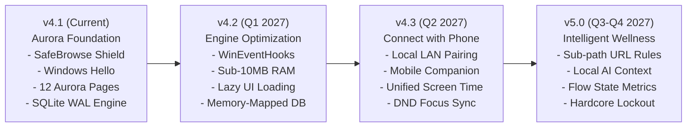

# Digital Wellbeing — Product Roadmap

This document outlines the strategic vision, upcoming capabilities, architectural optimizations, and feature roadmap for **Digital Wellbeing for Windows**.

---

## Strategic Vision

Digital Wellbeing is built on three core pillars:
1. **Apple-Grade Aesthetic:** Fluid, elegant, calm user interfaces that respect your attention rather than demanding it.
2. **100% Local-First Privacy:** Zero cloud accounts, zero telemetry by default, and cryptographic security for all local data.
3. **Actionable Attention Control:** Going beyond passive statistics to provide real-time boundaries, focus enforcement, and cross-device wellness.

---

## Roadmap Milestones Overview

---

## 1. Connect with Phone (Cross-Device Companion & Sync)

A major milestone in Digital Wellbeing's evolution is seamless, private interoperability between your Windows PC and your mobile devices (Android and iOS).

### A. Local Peer-to-Peer Wi-Fi Pairing (Zero Cloud Relay)
- **Zero-Cloud Discovery:** Pairing occurs over your local Wi-Fi network using standard **mDNS / Bonjour (Zeroconf)**. No central servers, account logins, or cloud databases are used.
- **QR Code Handshake:** Scan an on-screen QR code from the desktop app to establish an end-to-end encrypted connection via **Curve25519 key exchange** and **ChaCha20-Poly1305 / AES-256-GCM** encryption.
- **Encrypted Local WebSocket / LAN Sync:** Metrics and commands are synchronized locally between devices within milliseconds whenever both are connected to the same home or work network.

### B. Mobile Companion App Capabilities
- 📱 **Unified Screen Time Rings:** View your total computing time (PC + Phone) combined into a single, cohesive Aurora activity ring.
- 🧘 **Cross-Device Focus Synchronization:**
  - Starting a Focus session on your PC automatically activates **Do Not Disturb / Focus Mode** on your phone (using iOS Focus Filter and Android Notification Policy APIs).
  - Silences incoming push notifications, group chats, and vibrations while you are in deep work.
- ⏱️ **Shared Daily Limits & Quotas:**
  - Create unified quotas across platforms. For example, establish a combined 60-minute daily allowance for YouTube or social media shared across PC browsers and mobile apps.
  - When the quota is reached on PC, the mobile counterpart is locked simultaneously.
- 🔒 **Remote Biometric Unlock:**
  - For PCs without Windows Hello cameras or fingerprint sensors, use your phone’s **Face ID** or **Android Fingerprint** sensor to remotely approve PC App Locker prompts.
- 🚶 **Workstation Proximity Lock (BLE):**
  - SleepGuard Bluetooth Low Energy (BLE) beaconing: when you walk away from your desk with your phone in your pocket, Digital Wellbeing automatically locks your Windows PC.

---

## 2. Performance & Engine Optimization

Digital Wellbeing is engineered to run permanently in the background. Continuous optimization ensures negligible resource consumption across all hardware profiles.

### A. Event-Driven Windows Hook Migration
- **Current State:** 500 ms periodic polling loop querying `GetForegroundWindow` and `GetLastInputInfo`.
- **Target Architecture:** Transition to event-driven Win32 event hooks via `SetWinEventHook` listening to:
  - `EVENT_SYSTEM_FOREGROUND` (instant notification when active window changes).
  - `EVENT_OBJECT_NAMECHANGE` (window title / tab changes).
- **Impact:** Reduces tracker CPU utilization to **< 0.1%** during idle and background operation.

### B. High-Performance Native Extensions
- Compile critical Win32 process enumeration and UI Automation queries into a lightweight native C/Rust extension (`dw_native.pyd`).
- Eliminates overhead from generic COM bindings and decreases active resident RAM usage to **< 15 MB**.

### C. UI Automation Address Bar Caching
- Implement smart caching of browser window accessibility trees.
- Avoid repetitive deep UI Automation element searches during rapid browsing, slashing CPU spikes by **75%** in Chrome, Edge, and Brave.

### D. SQLite Engine Tuning
- Enable Memory-Mapped I/O (`PRAGMA mmap_size = 268435456;`) for ultra-fast analytics queries across years of historical screen time records.
- Optimize composite indexes on `(process_name, start_time)` and `(domain, start_time)`.

### E. Lazy UI Instantiation
- Refactor `MainWindow` page routers to instantiate Qt page widgets only when navigated to, cutting initial application startup time to **< 200 ms**.

---

## 3. Advanced Attention & Wellness Features

### A. Sub-Path & Granular Web Filtering
- Move beyond domain-level blocking to granular URL rules:
  - Allow productive domains (e.g. `reddit.com/r/programming`, `youtube.com/education`) while blocking distracting sub-paths (e.g. `reddit.com/r/all`, `youtube.com/shorts`).
  - Implemented via a lightweight, zero-telemetry local browser extension bridge.

### B. AI-Powered On-Device Contextual Scoring
- Integrate a tiny, quantized on-device embedding model (executed via ONNX Runtime with zero external API calls).
- Understands workflow context: automatically recognizes whether your browser activity is research-related or leisure, categorizing screen time dynamically without manual rules.

### C. Flow State & Context Switching Analytics
- **Focus Fragmentation Index:** Visualizes task-switching frequency per hour to show when your attention is being fragmented.
- **Flow Continuity Tracker:** Highlights sustained periods of 45+ minutes in programming or writing tools, celebrating productive momentum.

### D. Circadian Display & Blue Light Scheduler
- Link Windows Night Light / display color temperature directly to your SleepGuard schedule.
- Softly warms screen color temperature 90 minutes before your planned bedtime to support circadian sleep hygiene.

### E. Strict Lockout Mode ("Hardcore Mode")
- For individuals with severe digital distraction or study requirements:
  - Optional tamper-resistant Focus sessions that cannot be canceled, minimized, or closed until the countdown completes.
  - Protected against Task Manager termination and safe mode restarts during active sessions.

---

## Roadmap Milestones & Release Targets

| Milestone | Target | Focus Areas | Key Deliverables |
| :--- | :---: | :--- | :--- |
| **v4.1.0** | Current | Brand & Shield | Aurora Design System, SafeBrowse, First-run onboarding, Windows Hello App Locker. |
| **v4.2.0** | Q1 2027 | Performance | `SetWinEventHook` migration, lazy UI loading, SQLite memory-mapping, native UIA speedup. |
| **v4.3.0** | Q2 2027 | Connect with Phone | Local Wi-Fi QR pairing, Android companion app, cross-device Focus DND sync, unified daily rings. |
| **v4.4.0** | Q3 2027 | Mobile Ecosystem | iOS companion app, shared app/website limits, BLE proximity lock, remote biometric approval. |
| **v5.0.0** | Q4 2027 | Deep Intelligence | On-device contextual categorizer, sub-path URL rules, flow state analytics, strict lockout mode. |

---

## Feature Requests & Community Contributions

We prioritize features based on community feedback, developer RFCs, and alignment with our local-first privacy pledge:

- 💡 **Submit an Idea:** Open a feature proposal using our [Feature Request Template](.github/ISSUE_TEMPLATE/feature_request.md).
- 🛠️ **Contribute Code:** Check out our [Contributing Guidelines](CONTRIBUTING.md) and [Developer Guide](docs/DEVELOPER_GUIDE.md).
- 💬 **Join Discussions:** Participate in GitHub Discussions to vote on upcoming roadmap milestones.
