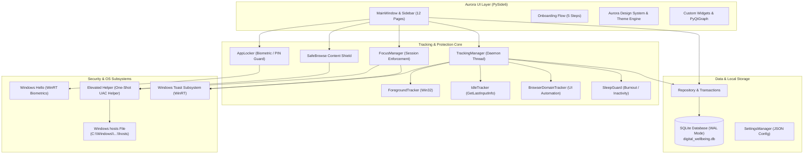
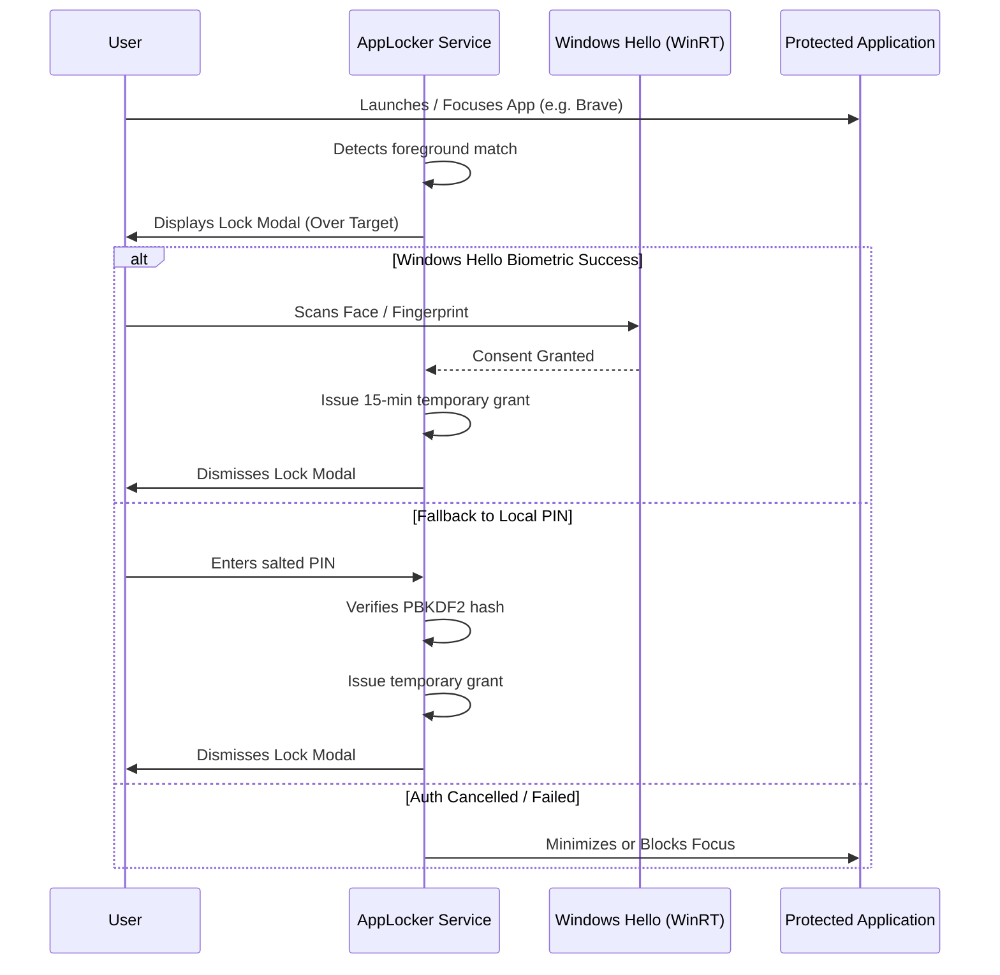

# Digital Wellbeing Architecture

This document provides a comprehensive technical breakdown of the architecture, design patterns, threading model, and data flow of **Digital Wellbeing for Windows**.

---

## 1. System Architecture Overview

Digital Wellbeing is built as a modular desktop application in Python 3.13 and PySide6 (Qt for Python). It operates as a local-first service with zero cloud dependencies, persisting all state to an embedded SQLite database using Write-Ahead Logging (WAL).



---

## 2. Core Subsystems

### A. Tracker Subsystem (`tracker/`)
The tracking engine runs independently of the user interface on a dedicated background thread. Since v4.2 it is **event-driven**: `tracker/win_events.py` installs `SetWinEventHook` hooks for active-window and title changes, and the loop sleeps until an event or a bounded timeout. A 2 s accounting tick keeps timers/limits accurate, while a 5 s safety poll re-reads the foreground window in case a hook is missed. If hooks are unavailable, the engine automatically falls back to 500 ms polling (`FOREGROUND_SAFETY_NO_HOOK_S`).

1. **Foreground Window Tracker (`tracker/foreground.py`):**
   - Receives `EVENT_SYSTEM_FOREGROUND` / `EVENT_OBJECT_NAMECHANGE` notifications from `ForegroundEventWatcher`, coalesced into a single wakeup.
   - Retrieved on demand via `win32gui.GetForegroundWindow()` (safety poll) rather than twice per second.
   - Resolves the process ID with `win32process.GetWindowThreadProcessId()`.
   - Obtains the full executable binary path using `win32process.QueryFullProcessImageNameW()` (or `psutil` as a fallback).
   - Reads the Unicode window title and identifies the root application name.
   - Maps process executables to categories (`AppCategory`) using rule-based heuristics in `tracker/categorizer.py`.

2. **Idle Detection (`tracker/idle.py`):**
   - Queries `GetLastInputInfo()` to compute milliseconds since the last physical input event (keystroke, mouse movement, click). Samples are cached for 2 s in the tracking loop.
   - Handles the 32-bit tick count wraparound (~49.7 days of continuous system uptime) by using 64-bit arithmetic.
   - XInput/joystick activity probing is throttled to once every 2 s instead of every sample.
   - When idle time exceeds `DEFAULT_IDLE_THRESHOLD_S` (default: 300 s / 5 min), an `IDLE_START` event is emitted, pausing active screen time accumulation.

3. **Browser Domain Tracker (`tracker/browser_domain.py`):**
   - Recognizes major browser executables (`chrome.exe`, `msedge.exe`, `brave.exe`, `firefox.exe`, `opera.exe`, `vivaldi.exe`, etc.).
   - Parses the window title first (memoised) for known services and explicit domains.
   - Falls back to Windows UI Automation only when the title is inconclusive: a single resolver thread with a bounded queue, latest-request-wins coalescing, a 30 s positive TTL, stale-while-revalidate, negative-cache backoff, and a 256-window LRU.
   - Strips protocol headers (`https://`), paths (`/watch`), and queries, retaining only the clean root domain (e.g., `github.com`).

4. **Tracking Coordinator (`tracker/manager.py`):**
   - Coordinates state between foreground detection, idle status, and active sessions.
   - Attributes each elapsed interval to the app that was active during it, then applies the transition; deltas are clamped to 5 s after hibernation.
   - Implements a **30-second heartbeat database synchronization**: sessions in progress are safely staged in memory and periodically committed to the database, ensuring zero data loss in the event of power outages or crashes.
   - Listens to native Win32 power management events (System Lock, Unlock, Sleep, Resume, Shutdown) and wakes the event loop immediately on state changes.
   - Exposes `get_performance_stats()` (hook availability, event wakeups, ticks, foreground queries) for Dev Mode.

---

### B. Protection & Access Control Subsystem (`protection/`)



1. **App Locker (`protection/app_locker.py`):**
   - Monitors active foreground processes against a user-defined list of locked executables.
   - When a locked application is brought to the foreground without an active grant, an on-screen authentication modal interrupts interaction.
   - Integrates with Windows Hello biometrics via `Windows.Security.Credentials.UI.UserConsentVerifier`.
   - Offers customizable grant durations: *Every Launch*, *5 Minutes*, *15 Minutes*, or *Until Application Closes*.

2. **Focus Mode (`protection/focus_manager.py`):**
   - Implements distraction-free work sessions using configurable presets (*Study*, *Work*, *Movie*, *Deep Focus*, *Custom*).
   - Supports **Allowlist Mode** (only approved applications may run) and **Blocklist Mode** (specified distracting applications are closed or minimized).
   - Enforces tab-level URL blocking by inspecting active browser tabs and closing unauthorized tabs via UI Automation.
   - **Granular sub-path rules** (`protection/url_rules.py`): host + path allow/block rules resolved most-specific-first, so `reddit.com/r/programming` can be allowed while `reddit.com/r/all` is blocked.
   - **Strict Lockout:** optional session mode with a persisted deadline; close/minimize/tray-quit guards and a best-effort relaunch watchdog (`protection/focus_watchdog.py`). It intentionally does not disable Task Manager or tamper with Safe Mode.
   - Enforces system-level DNS blocking of distracting domains during the focus session.

3. **Web Rules Bridge (`protection/extension_bridge.py`):**
   - Loopback-only HTTP server (`127.0.0.1`) with a per-install token; evaluates full URLs for the optional MV3 extension.
   - Endpoints: `GET /v1/health`, `POST /v1/check`. URLs are evaluated in memory and never logged or persisted.
   - The extension (`assets/browser_extension/`) fails open when the app is closed; without it, domain-level blocking continues through hosts.

4. **Circadian Display Scheduler (`protection/circadian.py`):**
   - Computes a colour-temperature ramp from the SleepGuard bedtime (default 90-minute lead, 6500 K → 3400 K).
   - Applies per-monitor gamma ramps via `GetDeviceGammaRamp`/`SetDeviceGammaRamp`, capturing originals and restoring them on disable/exit.
   - Deliberately avoids the undocumented Night Light registry blob; no elevation is needed.

5. **SafeBrowse Adult Content Shield (`protection/content_blocker.py`):**
   - Provides system-wide, browser-independent adult content filtering at the DNS resolution layer.
   - Synchronizes with curated, open-source blocklists (StevenBlack hosts, MIT License) and caches them in `%LOCALAPPDATA%\DigitalWellbeing\blocklist\`.
   - Ships with an offline seed list enabling immediate filtering from the first launch without requiring an active network connection.
   - Maintains an isolated hosts file block (`# DW-SAFEBROWSE`) that coexists cleanly with Focus Mode (`# DIGITAL WELLBEING BLOCK`).

6. **Privilege Separation & UAC Helper (`protection/elevated_helper.py` & `utils/elevation.py`):**
   - The primary application runs with standard user privileges.
   - Privileged operations (modifying `C:\Windows\System32\drivers\etc\hosts`) trigger a single elevated subprocess via `ShellExecuteEx` (`runas`).
   - The elevated helper validates arguments against a strict allowlist (`focus-apply`, `focus-remove`, `safebrowse-apply`, `safebrowse-remove`), performs atomic file writes with backup (`hosts.dw.bak`), flushes Windows DNS caches (`ipconfig /flushdns`), and communicates status via structured exit codes.

---

### C. Database & Persistence Subsystem (`database/`)

Digital Wellbeing uses SQLite 3 with **Write-Ahead Logging (WAL)** mode enabled:
- `PRAGMA journal_mode = WAL;` — Allows concurrent readers without blocking writes.
- `PRAGMA synchronous = NORMAL;` — Optimal balance between durability and write performance.
- `PRAGMA busy_timeout = 5000;` — Eliminates database locked errors during concurrent background transactions.
- `PRAGMA mmap_size = <adaptive 32–256 MB>;` — Memory-mapped reads sized to the database (disabled on 32-bit builds).
- `PRAGMA wal_autocheckpoint = 1000;` and `PRAGMA optimize` on close — bounded WAL growth and fresh index statistics.
- Composite indexes on `app_sessions(process_name, start_time)`, `app_sessions(category, start_time)`, `website_sessions(domain, start_time)`, and `website_sessions(browser_process, start_time)` keep per-app/per-domain analytics fast as history grows.

#### Primary Database Entities:
- **`sessions`:** Application run records (`id`, `process_name`, `app_title`, `executable_path`, `category`, `start_time`, `end_time`, `duration_seconds`).
- **`website_sessions`:** Domain tracking records (`id`, `domain`, `browser_process`, `start_time`, `end_time`, `duration_seconds`).
- **`app_limits`:** User quotas for applications (`process_name`, `daily_limit_seconds`, `warning_threshold_seconds`, `is_active`).
- **`website_limits`:** User quotas for domains (`domain`, `daily_limit_seconds`, `is_active`).
- **`focus_sessions`:** Historical focus records (`id`, `mode`, `target_duration_seconds`, `actual_duration_seconds`, `start_time`, `end_time`, `completed`).
- **`app_locker_config`:** Locked application registry and authentication settings.

---

### D. User Interface Subsystem (`ui/`)

The user interface follows the **Aurora Design System** (`ui/design_system.py`), an Apple-grade visual specification inspired by macOS Sequoia:

1. **Design Tokens:**
   - **Color Palette:** Apple system palette tokens (`systemBlue`, `systemGreen`, `systemOrange`, `systemPurple`, `systemRed`, `systemGray`, `systemIndigo`, `systemPink`, `systemTeal`).
   - **Typography:** Bundled Inter and Inter Display fonts with SF-metric weight and size hierarchies (Display, Title, Headline, Body, Caption).
   - **Radius Scale:** Consistent rounding scale (6px, 8px, 10px, 14px, 18px, 20px).
   - **Theme Engine:** Dynamic dark/light QSS stylesheets (`ui/theme.py`) responding to Windows system theme changes or manual user overrides.

2. **Navigation & Layout:**
   - Sidebar-driven navigation with 12 dedicated pages: *Dashboard*, *Activity*, *Focus*, *App Locker*, *App Timers*, *Websites*, *Insights*, *History*, *SleepGuard*, *Wellbeing*, *Daily Report*, and *Settings*.
   - **Lazy page router:** `QStackedWidget` placeholders reserve stable indices, and each page module is imported/constructed only on first navigation (`MainWindow._ensure_page`). Only the landing page exists at first paint.
   - **Focus page:** separate cards for mode selection, session/timer, tabbed guardrails (Apps / Websites / URL rules), and Session Protection; the active cockpit hides the stop action during lockout.
   - **Insights page:** adds Attention Quality cards for the Focus Fragmentation Index and Flow Continuity Tracker.
   - Animated page transitions: smooth 14px rise with quintic-out fade-in (260 ms).

3. **Visualization & Charts (`ui/widgets/charts.py`):**
   - High-performance real-time analytics powered by PyQtGraph with custom rounded-gradient bar visualizers.
   - Smooth animated donut sweep chart for category proportions.

4. **Onboarding Wizard (`ui/onboarding.py`):**
   - 5-step interactive first-run experience: Welcome & Personalization, Theme Selection, Focus Goals, SafeBrowse Opt-in, and Setup Summary.

---

## 3. Concurrency & Threading Model

```text
+-------------------------------------------------------------------+
|                        MAIN THREAD (Qt)                           |
|  - QApplication Event Loop                                         |
|  - Aurora UI Rendering, Widgets, Animations                       |
|  - User Input & Event Dispatching                                 |
|  - Receives signals from worker threads                           |
+---------------------------------+---------------------------------+
                                  | Signals / Thread Communication
+---------------------------------v---------------------------------+
|                   TRACKER DAEMON THREAD                           |
|  - TrackingManager Loop (event-driven, 2 s accounting tick)       |
|  - Win32 Foreground & Idle Detection (5 s safety poll)            |
|  - Coalesced UI Automation Browser Tab Queries                    |
|  - Memory Session Staging                                         |
|  - 30-Second Heartbeat SQLite WAL Writes                          |
+---------------------------------+---------------------------------+
                                  | Win32 events
+---------------------------------^---------------------------------+
|              FOREGROUND EVENT WATCHER THREAD                      |
|  - SetWinEventHook: foreground + title changes                    |
|  - Coalesces events into one wakeup                               |
+-------------------------------------------------------------------+
```

- **Thread Safety Invariant:** GUI components are modified **only** on the Main Thread.
- **Worker Isolation:** Network operations (update checks, blocklist downloads) and heavy file I/O execute on detached `threading.Thread` workers. Results are posted back to the main thread via Qt signals (`PySide6.QtCore.Signal`).
- **Extension Bridge:** a daemon `ThreadingHTTPServer` on `127.0.0.1` handles Web Rules queries independently of the UI.
- **Lockout Watchdog:** a separate unprivileged process waits for the deadline and relaunches the app once if the lockout process disappears; the parent terminates it on normal completion.
- **Database Concurrency:** SQLite in WAL mode permits simultaneous read queries from the UI thread while the tracker daemon writes heartbeat updates.

---

## 4. Security & Safety Boundaries

1. **Least-Privilege Execution:** The main executable always runs unprivileged.
2. **Deterministic Elevation:** UAC prompts are isolated to atomic hosts-file updates.
3. **Immutable Process Protection:** Operating system processes cannot be terminated by Focus Mode or App Locker.
4. **Biometric Isolation:** All biometrics are delegated to Windows Hello; no biometric keys or sensor frames ever touch Python process memory.
5. **Fail-Open Safety:** In the event of an allowlist misconfiguration, the system fails open rather than locking the user out of critical system tools.
